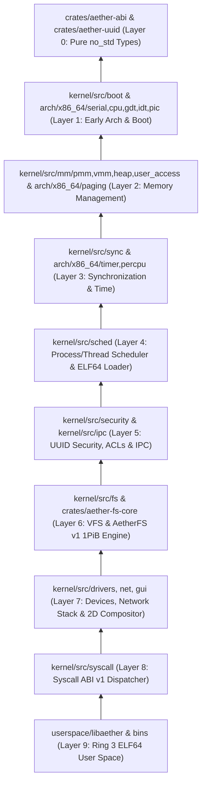

# AetherOS System Architecture

## 1. Architectural Principles

AetherOS is structured as a modular monolithic `x86_64` kernel written in `no_std` Rust with strictly isolated architecture-dependent assembly/hardware layers and portable `no_std` core crates (`aether-abi`, `aether-uuid`, `aether-fs-core`, `aether-elf`) that are shared between the kernel, Ring 3 user space, and host-side verification tests.

### Core Design Tenets
1. **Strict Privilege Separation**: All user applications execute in unprivileged **Ring 3** (`CS=0x2B`, `SS=0x23`) within isolated per-process 4-level page tables (`PML4[0..256]`). Kernel code and data reside exclusively in higher-half memory (`PML4[256..512]`, `0xffff800000000000..0xffffffffffffffff`) with `PTE_USER = 0`.
2. **Hardware-Enforced Memory Safety**: `CR0.WP` (Ring 0 Write Protect), `EFER.NXE` (No-Execute page protection), and `CR4.SMEP` (Supervisor Mode Execution Prevention) are enabled during early boot and enforced across all mappings (`W^X`).
3. **UUID-First Identity & Security**: Every user, group, and filesystem object carries a 128-bit UUID v4 alongside traditional POSIX `uid`/`gid` integers, enabling deterministic access control lists (ACLs) and audited `execute_as_uuid` execution transitions.
4. **Resilient Storage (AetherFS v1)**: 64-bit block addressing (`>= 1 PiB` volume capacity), dual superblocks (Primary LBA 1 + Backup LBA 2), Castagnoli CRC32C checksums on all metadata structures, and a Write-Ahead Journal (`AETHJRNL`) with automatic crash replay and torn-write rollback.

---

## 2. Virtual Address Space Layout (4-Level Paging, 48-Bit Canonical)

| Virtual Address Range | PML4 Entries | Privilege | Purpose |
| :--- | :--- | :--- | :--- |
| `0x0000_0000_0000_0000 .. 0x0000_0000_003F_FFFF` | `0` | Unmapped | Null-pointer & low-memory trap zone (4 MiB) |
| `0x0000_0000_0040_0000 .. 0x0000_0000_7FFF_FFFF` | `0` | Ring 3 (`U=1`) | User ELF64 executable segments (`.text` RX, `.rodata` R, `.data`/`.bss` RW+NX) and `brk` heap |
| `0x0000_4000_0000_0000 .. 0x0000_7FFF_0000_0000` | `128..255` | Ring 3 (`U=1`) | User `mmap` anonymous & `MAP_SHARED` shared-memory mappings |
| `0x0000_7FFF_FFFE_7000 .. 0x0000_7FFF_FFFE_7FFF` | `255` | Guard (`P=0`) | User stack bottom guard page (`PTE_GUARD`, triggers `#PF` on stack overflow) |
| `0x0000_7FFF_FFFE_8000 .. 0x0000_7FFF_FFFF_0000` | `255` | Ring 3 (`U=1`) | User Ring 3 stack (32 KiB RW+NX, top page holds `argv`, `envp`, `auxv`) |
| `0xFFFF_8000_0000_0000 .. 0xFFFF_8FFF_FFFF_FFFF` | `256..287` | Ring 0 (`U=0`) | Higher-Half Direct Map (HHDM) of physical RAM (`phys_to_virt`) |
| `0xFFFF_C000_0000_0000 .. 0xFFFF_C000_3FFF_FFFF` | `384` | Ring 0 (`U=0`) | Kernel Coalescing Heap (`#[global_allocator]`, RW+NX) |
| `0xFFFF_D000_0000_0000 .. 0xFFFF_DFFF_FFFF_FFFF` | `416..447` | Ring 0 (`U=0`) | Kernel VMM dynamic scratch, demand-paged, and COW test arenas |
| `0xFFFF_FFFF_8000_0000 .. 0xFFFF_FFFF_FFFF_FFFF` | `511` | Ring 0 (`U=0`) | Higher-Half Kernel ELF image (`.text` RX, `.rodata` R+NX, `.data`/`.bss` RW+NX) |

---

## 3. Subsystem Dependency Graph (Acyclic Layering)

No lower layer imports a higher layer, preventing circular dependencies and keeping architecture-specific `x86_64` code strictly isolated under `kernel/src/arch/x86_64/`.
