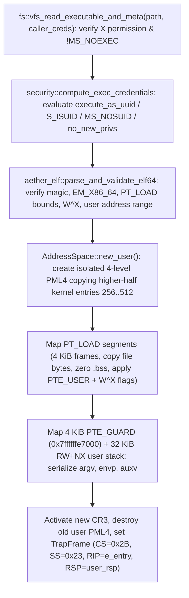

# AetherOS Executable Loading & Ring 3 Execution Model

See also [EXECUTABLE_AND_ELF_LOADER.md](file:///home/ubeyt/Belgeler/AetherOS/EXECUTABLE_AND_ELF_LOADER.md) and [INIT_AND_SERVICES.md](file:///home/ubeyt/Belgeler/AetherOS/INIT_AND_SERVICES.md).

## 1. ELF64 Loading & Ring 3 Entry Pipeline

## 2. User-Space Runtime (`userspace/libaether/src/lib.rs`)
- Entry symbol `_start(argc, argv, envp)` receives `(RDI, RSI, RDX)`, converts `argv` into `&[&str]`, invokes the binary's `main(args) -> i32`, and terminates cleanly via `SYS_EXIT(code)`.
- Provides a thread-safe 1 MiB `.bss` static bump `#[global_allocator]` so Ring 3 ELF64 binaries freely use `alloc::vec::Vec`, `alloc::string::String`, and `format!`.
