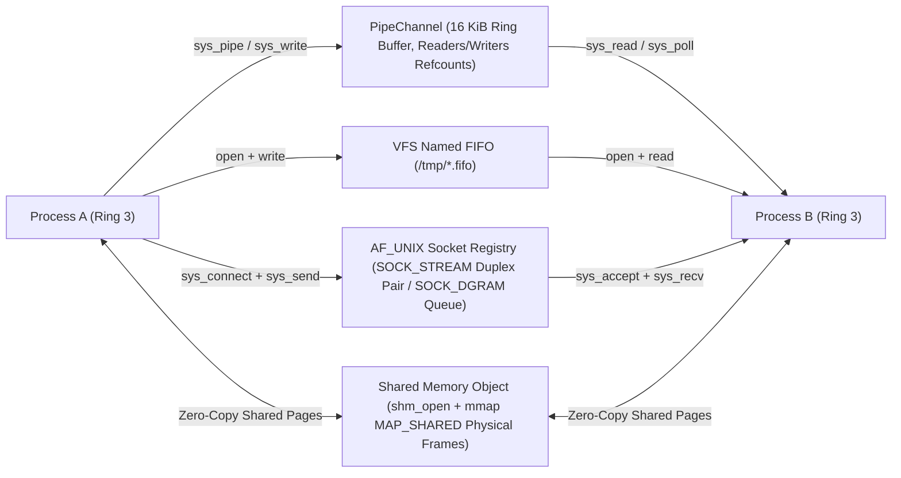

# AetherOS Inter-Process Communication (IPC) Architecture

See also [IPC_DESIGN.md](IPC_DESIGN.md).

## 1. IPC Transport Topology

## 2. Verified IPC Invariants (`test_ipc_pipes_unix_sockets_and_shm`)
1. **Anonymous Pipes (`SYS_PIPE` / `SYS_PIPE2`)**: Verified multi-stage `/bin/aethersh` pipelines (`cat /tmp/pipeline_test.txt | grep aether | wc -l`) with clean `EOF` propagation on writer exit and `EPIPE` + `SIGPIPE` when all readers close.
2. **Named FIFOs (`fs::vfs_mkfifo`)**: Verified persistent VFS FIFO nodes (`S_IFIFO`) routing byte streams across independent processes.
3. **Unix-Domain Sockets (`AF_UNIX`)**: Verified both connection-oriented `SOCK_STREAM` (`socket -> bind -> listen -> connect -> accept -> send/recv`) and connectionless `SOCK_DGRAM` message passing.
4. **Shared Memory (`SYS_SHM_OPEN` + `SYS_MMAP`)**: Verified cross-process physical page sharing via `MAP_SHARED`.
