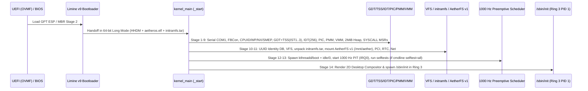

# AetherOS Kernel Specification

See also [KERNEL_DESIGN.md](KERNEL_DESIGN.md) and [ARCHITECTURE.md](ARCHITECTURE.md).

## 1. Kernel Execution & Memory Model

- **Target**: `x86_64-unknown-none` (`# ![no_std]`, `# ![no_main]`).
- **Virtual Base**: Higher-half `-2 GiB` (`0xffffffff80000000`) with Higher-Half Direct Map (`HHDM`) at `0xffff800000000000`.
- **Privilege Separation**:
  - **Ring 0 (`CS=0x08`, `SS=0x10`)**: Trusted kernel execution context.
  - **Ring 3 (`CS=0x2B`, `SS=0x23`)**: Unprivileged user-space execution context with isolated per-process `CR3` (`PML4[0..256]`).
- **Hardware Enforcements (`arch::x86_64::cpu`)**:
  - `CR0.WP = 1`: Ring 0 cannot write to read-only pages (enforcing Copy-on-Write even during kernel `copy_to_user`).
  - `EFER.NXE = 1`: Hardware No-Execute bit (`bit 63`) enforced on all data, heap, and stack pages (`W^X`).
  - `EFER.SCE = 1`: Fast `SYSCALL`/`SYSRET` privilege transition instructions enabled.
  - `CR4.PGE = 1`: Global TLB pages enabled for higher-half kernel mappings.
  - `CR4.SMEP = 1`: Supervisor Mode Execution Prevention blocks Ring 0 from executing code on `PTE_USER` pages.

---

## 2. Kernel Boot & Subsystem Initialization Sequence

