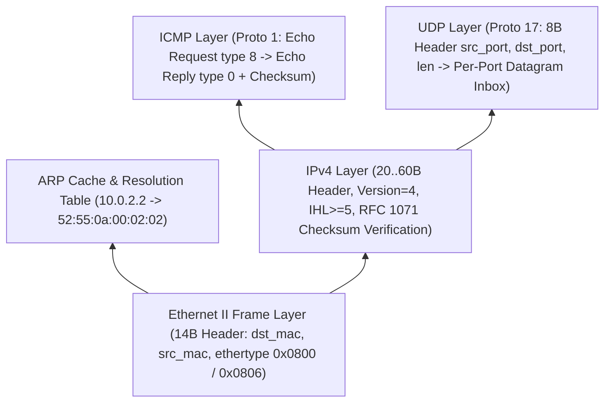

# AetherOS Networking Architecture

See also [NETWORK_STACK.md](NETWORK_STACK.md).

## 1. Protocol Stack Diagram

## 2. Verification & Fuzz Testing (`test_drivers_pci_rtc_and_network_stack`)
- Verified outbound/inbound ICMP Echo Request (`10.0.2.2 -> 10.0.2.15`, payload `"AetherOS-Ping-Payload"`) producing a valid RFC 1071 checksummed ICMP Echo Reply (`10.0.2.15 -> 10.0.2.2`).
- Verified UDP loopback datagram transmission and receipt on port `8080` (`127.0.0.1:40000 -> 127.0.0.1:8080`).
- Verified 2,000 mutated and randomly truncated IPv4/ICMP frames through `net::process_inbound_ipv4` with zero panics.
