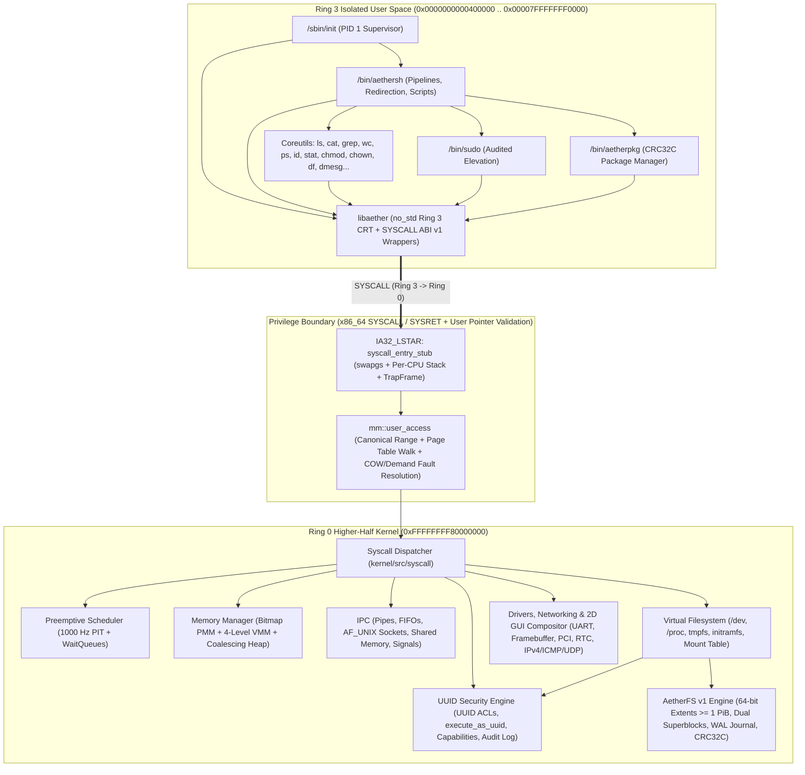

# AetherOS

**Independent modular x86_64 operating system featuring a custom higher-half Rust kernel, UUID-based identity and permission model, 1 PiB+ AetherFS journaling filesystem, Ring 3 process isolation, native ELF64 user-space environment, and 2D framebuffer desktop compositor.**

---

## Executive Overview

AetherOS is an independent, security-oriented, multi-user 64-bit (`x86_64` / `AMD64`) operating system engineered from the ground up without Linux kernel code, POSIX emulation layers, or simulated subsystems. Every component—from the higher-half kernel mapped at `0xffffffff80000000`, bitmap physical frame allocator with Copy-on-Write reference counting, 4-level page table manager (`W^X`, `SMEP`, `NX`, demand paging, guard pages), preemptive scheduler, `SYSCALL`/`SYSRET` ABI v1, and extent-based **AetherFS v1** (`>= 1 PiB` capacity with Castagnoli CRC32C checksums and Write-Ahead Journal recovery) to the compiled Ring 3 ELF64 user space (`/sbin/init`, `/bin/aethersh`, `/bin/sudo`, `/bin/aetherpkg`, and 28 core utilities)—executes natively on bare-metal/virtualized `x86_64` hardware in both **UEFI (OVMF)** and **Legacy BIOS** boot modes.

---

## Key Architectural Pillars

| Subsystem | Implementation Location | Key Capabilities |
| :--- | :--- | :--- |
| **Boot & CPU Layer** | `kernel/src/boot/`, `kernel/src/arch/x86_64/` | Limine Boot Protocol v3 handoff (UEFI + BIOS hybrid GPT disk), GDT with `SYSCALL`/`SYSRET` layout, 64-bit TSS with dedicated `IST1` (`#DF`), `IST2` (`#NMI`), `IST3` (`#MC`) stacks, 256-entry IDT, `CR0.WP`, `EFER.NXE`, `EFER.SCE`, `CR4.SMEP`, `CR4.PGE`, 16550 UART + linear framebuffer console |
| **Memory Management** | `kernel/src/mm/`, `kernel/src/arch/x86_64/paging.rs` | Fail-closed Bitmap Physical Memory Manager (PMM) with `SharedRefTable` COW frame refcounting & fragmentation reports; 4-level VMM (`PML4 -> PDPT -> PD -> PT`) enforcing `W^X`, Demand Paging (`PTE_DEMAND`), Copy-on-Write (`PTE_COW`), and Guard Pages (`PTE_GUARD`); Coalescing Kernel Heap (`#[global_allocator]`) with magic canary (`0xAE74_EC01`) & double-free detection |
| **Scheduler & Sync** | `kernel/src/sched/`, `kernel/src/sync/` | 1000 Hz PIT (`IRQ0`) preemptive priority round-robin scheduler + voluntary trap (`int 0x81`), kernel threads & Ring 3 processes, `fork`, `execve`, `wait4`, `exit`, `kill`, `SpinLock`, `IrqSpinLock`, `Mutex`, `Semaphore`, `RwLock`, `WaitQueue` |
| **Syscall ABI v1** | `crates/aether-abi/`, `kernel/src/syscall/` | Native `SYSCALL`/`SYSRET` entry via `IA32_LSTAR`, Per-CPU `GS_BASE`/`KERNEL_GS_BASE` stack switch, strict user pointer range validation (`mm::user_access`), explicit `SyscallStatus` table (zero fake stubs; unimplemented calls return `-ENOSYS`) |
| **IPC Architecture** | `kernel/src/ipc/` | Anonymous pipes (`pipe`/`pipe2`), named FIFOs (`mkfifo`), Unix-domain stream & datagram sockets (`AF_UNIX`), POSIX shared memory (`shm_open`/`shm_unlink` + `mmap`), signals (`SIGTERM`, `SIGKILL`, `SIGINT`, `SIGCHLD`, `SIGSEGV`, `SIGPIPE`), and `poll` |
| **VFS & AetherFS v1** | `kernel/src/fs/`, `crates/aether-fs-core/` | Unified VFS with Linux-like directory hierarchy (`/bin`, `/sbin`, `/boot`, `/dev`, `/etc`, `/home`, `/lib`, `/mnt`, `/opt`, `/proc`, `/root`, `/run`, `/tmp`, `/usr`, `/var`), `/dev` character devices, `/proc` diagnostics, USTAR `initramfs.tar`, and **AetherFS v1** (`>= 1 PiB` 64-bit extent filesystem, primary LBA 1 + backup LBA 2 superblocks, CRC32C checksums on superblocks/inodes/journal, WAL journal replay & torn-write rollback) |
| **UUID Security & ACLs** | `crates/aether-uuid/`, `kernel/src/security/` | First-class 128-bit UUID v4 identity model paired with POSIX UID/GID compatibility (`root` `00000000-0000-4000-8000-000000000001`), per-inode UUID ACL entries, root-controlled `execute_as_uuid` execution identity policy (enforcing `MS_NOSUID` and `no_new_privs`), kernel-audited `sudo` elevation, and `/tmp` sticky-bit deletion guards |
| **ELF64 & Ring 3 Userspace** | `crates/aether-elf/`, `kernel/src/sched/exec.rs`, `userspace/` | Fuzz-tested `no_std` ELF64 loader mapping `PT_LOAD` segments with `W^X` and guarded user stack (`argv`, `envp`, `auxv`); real compiled Ring 3 ELF64 binaries: `/sbin/init`, `/bin/aethersh` (pipelines `|`, redirections `>`/`>>`/`<`, quoting, `$VAR`), `/bin/sudo`, `/bin/aetherpkg`, and 28 core utilities |
| **Drivers, Net & GUI** | `kernel/src/drivers/`, `kernel/src/net/`, `kernel/src/gui/` | PCI Bus Type-1 scanner, CMOS RTC clock, PS/2 controller, Loopback + Ethernet/ARP/IPv4/ICMP/UDP network stack (fuzz-tested against 2,000 mutated packets), and Milestone 14 2D double-buffered framebuffer desktop compositor (`800x500` window manager, z-ordered windows, input event routing, `/proc/gui`) |

---

## System Architecture Diagram



---

## Repository Structure

```text
AetherOS/
├── Cargo.toml                     # Host workspace (shared crates & host unit/fuzz test suite)
├── crates/
│   ├── aether-abi/                # Stable Syscall ABI v1 numbers, Errno, Stat, Dirent, PollFd
│   ├── aether-uuid/               # RFC 4122 128-bit UUID v4 type, parser, and deterministic generator
│   ├── aether-fs-core/            # AetherFS v1 1 PiB+ extent filesystem engine, CRC32C, WAL journal
│   └── aether-elf/                # Strict no_std x86_64 ELF64 parser & validator (10k fuzz tested)
├── kernel/                        # Higher-half x86_64 bare-metal kernel (x86_64-unknown-none)
│   ├── linker.ld                  # Higher-half linker script (-2 GiB: 0xffffffff80000000, W^X aligned)
│   └── src/
│       ├── arch/x86_64/           # CPUID, GDT/TSS/IST, IDT, PIC, PIT, Paging, Per-CPU, SYSCALL stub
│       ├── boot/                  # Limine Boot Protocol v3 handoff parser
│       ├── drivers/               # Linear framebuffer console, PCI bus scanner, CMOS RTC
│       ├── fs/                    # VFS, FHS hierarchy, /dev, /proc, initramfs, AetherFS v1 mount
│       ├── gui/                   # Milestone 14 2D software compositor & desktop window manager
│       ├── ipc/                   # Pipes, FIFOs, AF_UNIX sockets, Shared Memory
│       ├── mm/                    # Bitmap PMM (with COW refcounts), 4-level VMM, Heap, user_access
│       ├── net/                   # Ethernet, ARP, IPv4, ICMP Echo, UDP loopback & fuzzing
│       ├── sched/                 # Preemptive scheduler, fork/wait4/exit, ELF64 execve loader
│       ├── security/              # UUID identity DB, ACL evaluator, execute_as_uuid, sudo audit log
│       ├── sync/                  # SpinLock, IrqSpinLock, Mutex, Semaphore, RwLock, WaitQueue
│       ├── syscall/               # Syscall ABI v1 table & handlers
│       └── selftest.rs            # Automated in-kernel verification suite (Milestones 1 - 14)
├── userspace/                     # Native Ring 3 ELF64 user-space workspace (x86_64-unknown-none)
│   ├── linker.ld                  # User-space ELF64 layout (0x0000000000400000, 4 KiB W^X segments)
│   ├── libaether/                 # Ring 3 runtime (_start, bump allocator, syscall wrappers)
│   └── bins/src/bin/
│       ├── init.rs                # /sbin/init (PID 1 service supervisor & zombie reaper)
│       ├── aethersh.rs            # /bin/aethersh (pipelines |, redirections > >> <, quoting, $VAR)
│       ├── coreutils.rs           # Multi-call ELF64 binary for 28 standard /bin utilities
│       ├── sudo.rs                # /bin/sudo (audited wheel elevation utility)
│       └── aetherpkg.rs           # /bin/aetherpkg (dependency-resolving package manager with CRC32C)
├── scripts/
│   ├── build.sh                   # Builds host crates, Ring 3 ELF64 userspace, and kernel ELF
│   ├── make-image.sh              # Packages initramfs.tar and builds hybrid UEFI+BIOS GPT disk image
│   ├── run-qemu.sh                # Boots AetherOS in QEMU (UEFI via OVMF or Legacy BIOS)
│   ├── test.sh                    # Runs host unit tests + automated QEMU UEFI & BIOS self-tests
│   ├── debug-qemu.sh              # Starts QEMU paused with GDB stub (-s -S)
│   ├── format.sh                  # Runs rustfmt across host workspace, kernel, and userspace
│   ├── lint.sh                    # Runs cargo clippy (-D warnings) across all 3 workspaces
│   └── clean.sh                   # Cleans build artifacts
└── docs/adr/                      # Architecture Decision Records (ADR 0001 - 0006)
```

---

## Quick Start: Build, Run, and Verify

### 1. Build Kernel, Ring 3 User-Space & Bootable Hybrid Image
```bash
./scripts/build.sh
./scripts/make-image.sh
```
Produces:
- `build/aetheros.elf` — Higher-half `x86_64` kernel ELF with symbols.
- `build/initramfs.tar` — USTAR archive containing compiled Ring 3 ELF64 binaries (`/sbin/init`, `/bin/aethersh`, `/bin/sudo`, `/bin/aetherpkg`, `/bin/ls`, `/bin/cat`, `/bin/grep`, `/bin/ps`, `/bin/id`, etc.) and `/etc` configuration.
- `build/aetheros.img` — Reproducible 64 MiB GPT hybrid disk image bootable via **UEFI (OVMF)** and **Legacy BIOS**.

### 2. Run Full Automated Verification Suite (Host + QEMU UEFI + QEMU BIOS)
```bash
./scripts/test.sh
```
Executes:
1. **14 host unit & fuzz tests** (`aether-abi`, `aether-uuid`, `aether-elf` 10,000-mutation fuzz test, `aether-fs-core` 1 PiB sparse file + superblock failover + WAL journal crash recovery).
2. **19 in-kernel & Ring 3 QEMU self-test suites** across **both UEFI (OVMF) and Legacy BIOS**, exiting via `isa-debug-exit` with status `33` (`PASS`).

### 3. Boot Interactively in QEMU
```bash
# Default UEFI boot (OVMF):
./scripts/run-qemu.sh

# Legacy BIOS boot:
./scripts/run-qemu.sh --bios
```

---

## Documentation Index

All architectural specifications and engineering reports are maintained in the repository root:

- [ARCHITECTURE.md](file:///home/ubeyt/Belgeler/AetherOS/ARCHITECTURE.md) — High-level modular architecture and subsystem dependency graph
- [KERNEL_DESIGN.md](file:///home/ubeyt/Belgeler/AetherOS/KERNEL_DESIGN.md) — Higher-half kernel execution model, CPU init, GDT/TSS/IDT, and synchronization
- [MEMORY_MANAGEMENT.md](file:///home/ubeyt/Belgeler/AetherOS/MEMORY_MANAGEMENT.md) — PMM bitmap allocator, COW refcounting, 4-level VMM, demand paging, and kernel heap
- [PROCESS_AND_SCHEDULING.md](file:///home/ubeyt/Belgeler/AetherOS/PROCESS_AND_SCHEDULING.md) — Task lifecycle, 1000 Hz preemptive scheduler, context switching, `fork`/`execve`/`wait4`
- [SYSCALL_SPEC.md](file:///home/ubeyt/Belgeler/AetherOS/SYSCALL_SPEC.md) — Syscall ABI v1 specification, register conventions, and complete syscall status table
- [IPC_DESIGN.md](file:///home/ubeyt/Belgeler/AetherOS/IPC_DESIGN.md) — Pipes, named FIFOs, `AF_UNIX` sockets, shared memory, signals, and `poll`
- [VFS_DESIGN.md](file:///home/ubeyt/Belgeler/AetherOS/VFS_DESIGN.md) — Virtual filesystem layer, FHS directory layout, `/dev`, `/proc`, and mount flags
- [AETHERFS_SPEC.md](file:///home/ubeyt/Belgeler/AetherOS/AETHERFS_SPEC.md) — AetherFS v1 on-disk format (`>= 1 PiB` 64-bit extents, dual superblocks, WAL journal, CRC32C)
- [USER_GROUP_UUID_SECURITY.md](file:///home/ubeyt/Belgeler/AetherOS/USER_GROUP_UUID_SECURITY.md) — 128-bit UUID v4 identity model and POSIX UID/GID mapping
- [PERMISSIONS_AND_ACL.md](file:///home/ubeyt/Belgeler/AetherOS/PERMISSIONS_AND_ACL.md) — Mode bits, sticky bit, UUID ACL evaluation order, and `execute_as_uuid` transitions
- [SUDO_AND_PRIVILEGE_MODEL.md](file:///home/ubeyt/Belgeler/AetherOS/SUDO_AND_PRIVILEGE_MODEL.md) — Capability bitmask, kernel-controlled `sudo` elevation, and audit logging
- [EXECUTABLE_AND_ELF_LOADER.md](file:///home/ubeyt/Belgeler/AetherOS/EXECUTABLE_AND_ELF_LOADER.md) — ELF64 validation, `PT_LOAD` mapping, and initial Ring 3 stack layout (`argv`, `envp`, `auxv`)
- [INIT_AND_SERVICES.md](file:///home/ubeyt/Belgeler/AetherOS/INIT_AND_SERVICES.md) — `/sbin/init` PID 1 supervisor and `/etc/services.conf` specification
- [SHELL_AND_UTILITIES.md](file:///home/ubeyt/Belgeler/AetherOS/SHELL_AND_UTILITIES.md) — `/bin/aethersh` grammar, pipelines, redirection, built-ins, and 28 core utilities
- [PACKAGE_MANAGER.md](file:///home/ubeyt/Belgeler/AetherOS/PACKAGE_MANAGER.md) — `/bin/aetherpkg` repository catalog, dependency resolution, and CRC32C verification
- [DRIVERS_AND_DEVICES.md](file:///home/ubeyt/Belgeler/AetherOS/DRIVERS_AND_DEVICES.md) — UART, framebuffer, PCI bus enumeration, CMOS RTC, and character devices
- [NETWORK_STACK.md](file:///home/ubeyt/Belgeler/AetherOS/NETWORK_STACK.md) — Loopback, Ethernet, ARP, IPv4, ICMP Echo, UDP datagrams, and packet fuzzing
- [GUI_ARCHITECTURE.md](file:///home/ubeyt/Belgeler/AetherOS/GUI_ARCHITECTURE.md) — Milestone 14 2D software compositor, window manager, z-order, and input routing
- [SECURITY_HARDENING.md](file:///home/ubeyt/Belgeler/AetherOS/SECURITY_HARDENING.md) — Hardware (`SMEP`, `NX`, `WP`) and software hardening controls
- [TESTING_AND_VERIFICATION.md](file:///home/ubeyt/Belgeler/AetherOS/TESTING_AND_VERIFICATION.md) — Host and QEMU UEFI/BIOS test matrix and latest verification transcripts
- [BENCHMARKS.md](file:///home/ubeyt/Belgeler/AetherOS/BENCHMARKS.md) — Real `RDTSC` hardware cycle measurements for PMM, heap, VFS, and AetherFS
- [BUILD_AND_QEMU_GUIDE.md](file:///home/ubeyt/Belgeler/AetherOS/BUILD_AND_QEMU_GUIDE.md) — Toolchain setup, build pipeline, QEMU invocation, and GDB debugging
- [ROADMAP.md](file:///home/ubeyt/Belgeler/AetherOS/ROADMAP.md) — Completed Milestone 0–14 delivery status and future expansion roadmap
