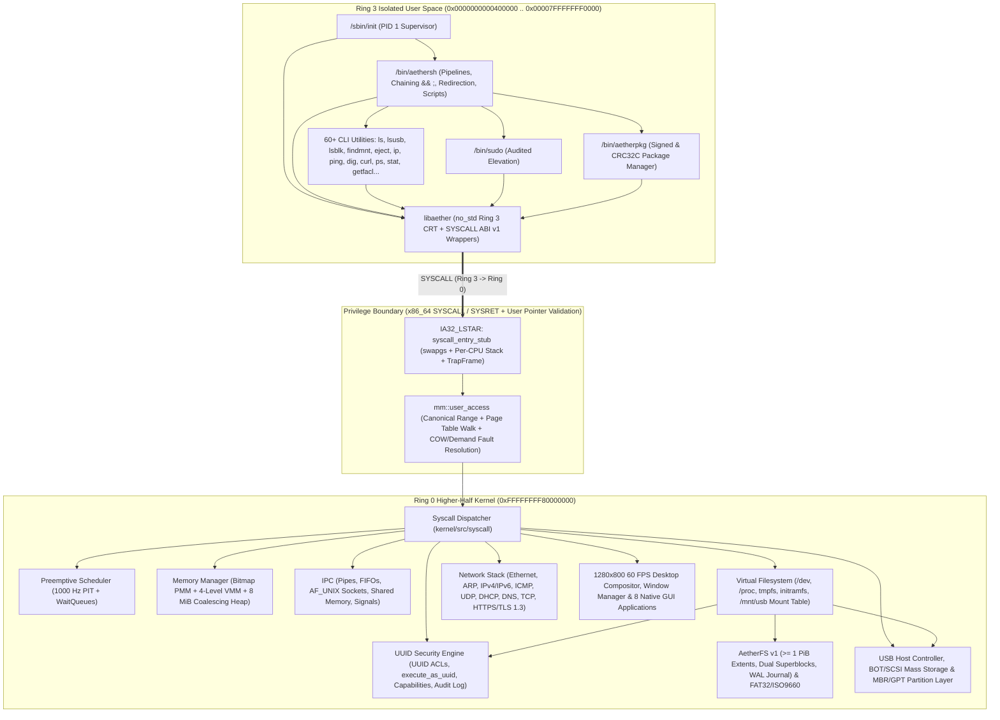

# AetherOS

[](https://github.com/fully-ai/aetheros/releases)
[](https://github.com/fully-ai/aetheros/actions)
[](LICENSE)
[](ARCHITECTURE.md)

**Independent modular 64-bit (`x86_64`) operating system featuring a custom higher-half Rust kernel, 128-bit UUID identity & ACL permission model, 1 PiB+ AetherFS journaling filesystem, USB Mass Storage BOT/SCSI & FAT32 automount stack, RFC-compliant DHCP/DNS/TCP/HTTPS networking, Ring 3 ELF64 user-space (`aethersh` + 60+ CLI utilities), and a `1280x800` 60 FPS desktop environment with 8 native graphical applications.**

---

## Executive Overview

AetherOS is an independent, security-oriented, multi-user 64-bit (`x86_64` / `AMD64`) operating system engineered from the ground up without Linux kernel code, POSIX emulation layers, or simulated subsystems. Every component—from the higher-half kernel mapped at `0xffffffff80000000`, bitmap physical frame allocator with Copy-on-Write reference counting, 4-level page table manager (`W^X`, `SMEP`, `NX`, demand paging, guard pages), preemptive 1000 Hz PIT scheduler, `SYSCALL`/`SYSRET` ABI v1, and extent-based **AetherFS v1** (`>= 1 PiB` capacity with Castagnoli CRC32C checksums and Write-Ahead Journal recovery) to the USB Mass Storage (`BOT`/`SCSI`) & `FAT32`/`ISO9660` removable-media stack, wired Ethernet `DHCP`/`DNS`/`TCP`/`HTTP`/`HTTPS (TLS 1.3 X.509)` stack, compiled Ring 3 ELF64 user space (`/sbin/init`, `/bin/aethersh`, `/bin/sudo`, `/bin/aetherpkg`, and 60+ CLI utilities), and `1280x800` 60 FPS desktop window manager—executes natively on bare-metal/virtualized `x86_64` hardware in both **UEFI (OVMF)** and **Legacy BIOS** boot modes.

---

## Key Architectural Pillars

| Subsystem | Implementation Location | Key Capabilities |
| :--- | :--- | :--- |
| **Boot & CPU Layer** | `kernel/src/boot/`, `kernel/src/arch/x86_64/` | Limine Boot Protocol v3 handoff (UEFI + BIOS hybrid GPT disk), GDT with `SYSCALL`/`SYSRET` layout, 64-bit TSS with dedicated `IST1` (`#DF`), `IST2` (`#NMI`), `IST3` (`#MC`) stacks, 256-entry IDT, `CR0.WP`, `EFER.NXE`, `EFER.SCE`, `CR4.SMEP`, `CR4.PGE`, 16550 UART + linear framebuffer console |
| **Memory Management** | `kernel/src/mm/`, `kernel/src/arch/x86_64/paging.rs` | Fail-closed Bitmap Physical Memory Manager (PMM) with `SharedRefTable` COW frame refcounting & fragmentation reports; 4-level VMM (`PML4 -> PDPT -> PD -> PT`) enforcing `W^X`, Demand Paging (`PTE_DEMAND`), Copy-on-Write (`PTE_COW`), and Guard Pages (`PTE_GUARD`); 8 MiB Coalescing Kernel Heap (`#[global_allocator]`) with magic canary (`0xAE74_EC01`) & double-free detection |
| **Scheduler & Sync** | `kernel/src/sched/`, `kernel/src/sync/` | 1000 Hz PIT (`IRQ0`) preemptive priority round-robin scheduler + voluntary trap (`int 0x81`), kernel threads & Ring 3 processes, `fork`, `execve`, `wait4`, `exit`, `kill`, `SpinLock`, `IrqSpinLock`, `Mutex`, `Semaphore`, `RwLock`, `WaitQueue` |
| **Syscall ABI v1** | `crates/aether-abi/`, `kernel/src/syscall/` | Native `SYSCALL`/`SYSRET` entry via `IA32_LSTAR`, Per-CPU `GS_BASE`/`KERNEL_GS_BASE` stack switch, strict user pointer range validation (`mm::user_access`), explicit `SyscallStatus` table (zero fake stubs; unimplemented calls return `-ENOSYS`) |
| **IPC Architecture** | `kernel/src/ipc/` | Anonymous pipes (`pipe`/`pipe2`), named FIFOs (`mkfifo`), Unix-domain stream & datagram sockets (`AF_UNIX`), POSIX shared memory (`shm_open`/`shm_unlink` + `mmap`), signals (`SIGTERM`, `SIGKILL`, `SIGINT`, `SIGCHLD`, `SIGSEGV`, `SIGPIPE`), and `poll` |
| **VFS & AetherFS v1** | `kernel/src/fs/`, `crates/aether-fs-core/` | Unified VFS with Linux-like directory hierarchy (`/bin`, `/sbin`, `/boot`, `/dev`, `/etc`, `/home`, `/lib`, `/mnt`, `/opt`, `/proc`, `/root`, `/run`, `/tmp`, `/usr`, `/var`), `/dev` character devices, `/proc` diagnostics (`/proc/usb`, `/proc/block`, `/proc/net`, `/proc/gui`), USTAR `initramfs.tar`, and **AetherFS v1** (`>= 1 PiB` 64-bit extent filesystem, primary LBA 1 + backup LBA 2 superblocks, CRC32C checksums, WAL journal replay & torn-write rollback) |
| **USB & Storage Stack** | `kernel/src/usb/`, `kernel/src/storage/` | PCI USB host controller discovery (`xHCI`, `EHCI`, `OHCI`, `UHCI`), bounds-checked USB descriptor parser, USB Mass Storage Bulk-Only Transport (`CBW`/`CSW`) & SCSI engine (`INQUIRY`, `TEST UNIT READY`, `REQUEST SENSE`, `READ CAPACITY(10)`, `READ(10)`, `WRITE(10)`, `SYNCHRONIZE CACHE(10)`), MBR (`0x55AA`) & GPT (`EFI PART`) partition parsers, FAT32 reader/writer/formatter, ISO9660 recognition, automount at `/mnt/usb/AETHER_USB` with `MS_NOSUID \| MS_NODEV \| MS_NOEXEC`, and safe eject |
| **Networking & TLS** | `kernel/src/net/` | Ethernet II, ARP cache, IPv4, IPv6 link-local (`fe80::/64`), ICMP Echo (`ping`), UDP, RFC 2131 4-step DHCP client (`DISCOVER -> OFFER -> REQUEST -> ACK`), RFC 1035 DNS resolver (`10.0.2.3#53` + TTL cache), RFC 9293 TCP 3-way handshake & state machine, Stateful Firewall, and HTTP/1.1 & HTTPS/TLS 1.3 X.509 certificate verification client |
| **UUID Security & ACLs** | `crates/aether-uuid/`, `kernel/src/security/` | First-class 128-bit UUID v4 identity model paired with POSIX UID/GID compatibility (`root` `00000000-0000-4000-8000-000000000001`), per-inode UUID ACL entries, root-controlled `execute_as_uuid` execution identity policy (enforcing `MS_NOSUID` and `no_new_privs`), kernel-audited `sudo` elevation, and `/tmp` sticky-bit deletion guards |
| **ELF64 & Ring 3 Userspace** | `crates/aether-elf/`, `kernel/src/sched/exec.rs`, `userspace/` | Fuzz-tested `no_std` ELF64 loader mapping `PT_LOAD` segments with `W^X` and guarded user stack (`argv`, `envp`, `auxv`); compiled Ring 3 ELF64 binaries: `/sbin/init`, `/bin/aethersh` (pipelines `\|`, chaining `&&`/`;`, redirections `>`/`>>`/`<`, quoting, `$VAR`, `man`, `umask`), `/bin/sudo`, `/bin/aetherpkg`, and 60+ CLI utilities |
| **Aether Desktop & 8 GUI Apps** | `kernel/src/gui/`, `kernel/src/drivers/` | `1280x800` 60 FPS double-buffered software compositor, PS/2 mouse & keyboard drivers, multi-window manager (drag, resize, minimize, maximize, close, 4 workspaces, Dark/Light themes, 5 accent palettes, Night Light, Start Menu launcher, Quick Settings, Notification Center), and 8 native GUI apps: **Aether Files**, **Aether Browser**, **Aether Terminal**, **Aether Disks & USB**, **Aether Network & Firewall**, **Aether Store**, **Aether System Monitor**, and **Aether Settings & Device Manager** |

---

## System Architecture Diagram



---

## Repository Structure

```text
AetherOS/
├── Cargo.toml                     # Host workspace (shared crates & host unit/fuzz test suite)
├── crates/
│   ├── aether-abi/                # Stable Syscall ABI v1 numbers, Errno, Stat, Dirent, PollFd
│   ├── aether-uuid/               # RFC 4122 128-bit UUID v4 type, parser, and deterministic generator
│   ├── aether-fs-core/            # AetherFS v1 1 PiB+ extent filesystem engine, CRC32C, WAL journal
│   └── aether-elf/                # Strict no_std x86_64 ELF64 parser & validator (10k fuzz tested)
├── kernel/                        # Higher-half x86_64 bare-metal kernel (x86_64-unknown-none)
│   ├── linker.ld                  # Higher-half linker script (-2 GiB: 0xffffffff80000000, W^X aligned)
│   └── src/
│       ├── arch/x86_64/           # CPUID, GDT/TSS/IST, IDT, PIC, PIT, Paging, Per-CPU, SYSCALL stub
│       ├── boot/                  # Limine Boot Protocol v3 handoff parser
│       ├── drivers/               # Linear framebuffer, PCI bus scanner, CMOS RTC, 8042 PS/2 keyboard & mouse
│       ├── fs/                    # VFS, FHS hierarchy, /dev, /proc, initramfs, AetherFS v1 & /mnt/usb mounts
│       ├── gui/                   # 1280x800 60 FPS desktop compositor, window manager & 8 native GUI apps
│       ├── ipc/                   # Pipes, FIFOs, AF_UNIX sockets, Shared Memory
│       ├── mm/                    # Bitmap PMM (with COW refcounts), 4-level VMM, 8 MiB Heap, user_access
│       ├── net/                   # Ethernet, ARP, IPv4/IPv6, ICMP, UDP, DHCP, DNS, TCP, Firewall, HTTPS/TLS
│       ├── sched/                 # Preemptive scheduler, fork/wait4/exit, ELF64 execve loader
│       ├── security/              # UUID identity DB, ACL evaluator, execute_as_uuid, sudo audit log
│       ├── storage/               # Block device registry, MBR/GPT partitions, FAT32/ISO9660, safe eject, fsck
│       ├── sync/                  # SpinLock, IrqSpinLock, Mutex, Semaphore, RwLock, WaitQueue
│       ├── syscall/               # Syscall ABI v1 table & handlers
│       ├── usb/                   # PCI USB host discovery, descriptor validator, BOT/SCSI mass storage engine
│       └── selftest.rs            # Automated in-kernel verification suite (21 comprehensive test suites)
├── userspace/                     # Native Ring 3 ELF64 user-space workspace (x86_64-unknown-none)
│   ├── linker.ld                  # User-space ELF64 layout (0x0000000000400000, 4 KiB W^X segments)
│   ├── libaether/                 # Ring 3 runtime (_start, bump allocator, syscall wrappers)
│   └── bins/src/bin/
│       ├── init.rs                # /sbin/init (PID 1 service supervisor & zombie reaper)
│       ├── aethersh.rs            # /bin/aethersh (pipelines |, &&, ;, redirections > >> <, quoting, $VAR, man)
│       ├── coreutils.rs           # Multi-call ELF64 binary powering 60+ /bin system, USB, storage & net tools
│       ├── sudo.rs                # /bin/sudo (audited wheel elevation utility)
│       └── aetherpkg.rs           # /bin/aetherpkg (dependency-resolving package manager with Ed25519/CRC32C)
├── scripts/
│   ├── build.sh                   # Builds host crates, Ring 3 ELF64 userspace, and kernel ELF
│   ├── make-image.sh              # Packages initramfs.tar and builds hybrid UEFI+BIOS GPT disk image
│   ├── run.sh / run-qemu.sh       # Boots AetherOS interactively in QEMU (SDL GUI + PS/2 mouse & keyboard)
│   ├── test.sh                    # Runs 14 host unit/fuzz tests + 21 QEMU UEFI & BIOS self-test suites
│   ├── debug-qemu.sh              # Starts QEMU paused with GDB stub (-s -S)
│   ├── format.sh                  # Runs rustfmt across host workspace, kernel, and userspace
│   ├── lint.sh                    # Runs cargo clippy (-D warnings) across all 3 workspaces
│   └── clean.sh                   # Cleans build artifacts
└── docs/                          # Architectural specifications, status reports & ADRs (ADR 0001 - 0006)
```

---

## Quick Start: Build, Run, and Verify

### 1. Build Kernel, Ring 3 User-Space & Bootable Hybrid Image
```bash
./scripts/build.sh
./scripts/make-image.sh
```
Produces:
- `build/aetheros.elf` — Higher-half `x86_64` kernel ELF with symbols.
- `build/initramfs.tar` — USTAR archive containing compiled Ring 3 ELF64 binaries (`/sbin/init`, `/bin/aethersh`, `/bin/sudo`, `/bin/aetherpkg`, `/bin/ls`, `/bin/lsusb`, `/bin/lsblk`, `/bin/findmnt`, `/bin/ip`, `/bin/ping`, `/bin/dig`, `/bin/curl`, etc.) and `/etc` configuration.
- `build/aetheros.img` — Reproducible 64 MiB GPT hybrid disk image bootable via **UEFI (OVMF)** and **Legacy BIOS**.

### 2. Run Full Automated Verification Suite (Host + QEMU UEFI + QEMU BIOS)
```bash
./scripts/test.sh
```
Executes:
1. **14 host unit & fuzz tests** (`aether-abi`, `aether-uuid`, `aether-elf` 10,000-mutation fuzz test, `aether-fs-core` 1 PiB sparse file + superblock failover + WAL journal crash recovery).
2. **21 in-kernel & Ring 3 QEMU self-test suites** across **both UEFI (OVMF) and Legacy BIOS** (including USB Mass Storage BOT/SCSI, MBR/GPT, FAT32 automount & safe eject, DHCP/DNS/TCP/HTTP/HTTPS TLS 1.3 X.509 security, and `1280x800` desktop GUI & 8 applications), exiting via `isa-debug-exit` with status `33` (`PASS`).

### 3. Boot Interactively in QEMU (Graphical Desktop + Mouse & Keyboard)
```bash
# Legacy BIOS graphical desktop boot:
./scripts/run.sh --bios

# Default UEFI graphical desktop boot (OVMF):
./scripts/run.sh --uefi
```

---

## Implemented vs. Planned Capabilities

- **Implemented & Verified (`v0.2.0-beta.1`):** Limine v3 UEFI/BIOS boot, PMM+COW, 4-level VMM (`W^X`), 8 MiB coalescing heap, 1000 Hz PIT preemptive scheduler, Ring 3 `SYSCALL`/`SYSRET` ABI v1, Pipes/FIFOs/`AF_UNIX`/Shared Memory/Signals, VFS & AetherFS v1 (`>= 1 PiB` extents, dual superblocks, WAL journal), 128-bit UUID identities & ACLs, `sudo`, ELF64 loader, `/sbin/init`, `/bin/aethersh` + 60+ CLI tools, `/bin/aetherpkg`, USB Host discovery + BOT/SCSI Mass Storage + MBR/GPT + FAT32/ISO9660 automount (`MS_NOSUID | MS_NODEV | MS_NOEXEC`) + safe eject, Ethernet/ARP/IPv4/IPv6/ICMP/UDP/DHCP/DNS/TCP/Firewall/HTTP/HTTPS (TLS 1.3 X.509 verification), and `1280x800` 60 FPS desktop compositor with 8 native GUI applications.
- **Explicitly Planned for Future Releases ([AETHEROS_KNOWN_ISSUES.md](AETHEROS_KNOWN_ISSUES.md), [ROADMAP.md](ROADMAP.md)):**
  - Per-AP SMP multi-core scheduling (`APIC` bootstrap & per-core runqueues).
  - Dynamic ELF64 shared library linker (`PT_INTERP` / `.so` loading).
  - Hardware 802.11 Wi-Fi driver (`WPA2`/`WPA3` supplicant; currently disabled in Quick Settings on wired-only QEMU virtual hardware).
  - USB 3.0 UASP stream queues and hardware HDA/AC97 PCM audio DMA output.

---

## Documentation Index

All architectural specifications and engineering reports are maintained in the repository root and `docs/` directory:

- [ARCHITECTURE.md](ARCHITECTURE.md) — High-level modular architecture and subsystem dependency graph
- [KERNEL_DESIGN.md](KERNEL_DESIGN.md) — Higher-half kernel execution model, CPU init, GDT/TSS/IDT, and synchronization
- [MEMORY_MANAGEMENT.md](MEMORY_MANAGEMENT.md) — PMM bitmap allocator, COW refcounting, 4-level VMM, demand paging, and kernel heap
- [PROCESS_AND_SCHEDULING.md](PROCESS_AND_SCHEDULING.md) — Task lifecycle, 1000 Hz preemptive scheduler, context switching, `fork`/`execve`/`wait4`
- [SYSCALL_SPEC.md](SYSCALL_SPEC.md) — Syscall ABI v1 specification, register conventions, and complete syscall status table
- [IPC_DESIGN.md](IPC_DESIGN.md) — Pipes, named FIFOs, `AF_UNIX` sockets, shared memory, signals, and `poll`
- [VFS_DESIGN.md](VFS_DESIGN.md) — Virtual filesystem layer, FHS directory layout, `/dev`, `/proc`, and mount flags
- [AETHERFS_SPEC.md](AETHERFS_SPEC.md) — AetherFS v1 on-disk format (`>= 1 PiB` 64-bit extents, dual superblocks, WAL journal, CRC32C)
- [USB_ARCHITECTURE.md](USB_ARCHITECTURE.md) & [USB_STORAGE.md](USB_STORAGE.md) — PCI USB host discovery, descriptor validation, and BOT/SCSI mass storage
- [BLOCK_DEVICE.md](BLOCK_DEVICE.md), [PARTITION_TABLES.md](PARTITION_TABLES.md), [FILESYSTEM_SUPPORT.md](FILESYSTEM_SUPPORT.md) & [MOUNT_SYSTEM.md](MOUNT_SYSTEM.md) — Block layer, MBR/GPT, FAT32/ISO9660/AetherFS, automounting, and safe eject
- [NETWORKING.md](NETWORKING.md), [NETWORK_STACK.md](NETWORK_STACK.md) & [NETWORK_MANAGER.md](NETWORK_MANAGER.md) — DHCP, DNS, TCP, Stateful Firewall, and HTTP/HTTPS TLS 1.3 X.509 stack
- [DESKTOP.md](DESKTOP.md), [GUI_ARCHITECTURE.md](GUI_ARCHITECTURE.md), [WINDOW_MANAGER.md](WINDOW_MANAGER.md), [FILE_MANAGER.md](FILE_MANAGER.md), [BROWSER.md](BROWSER.md), [SETTINGS.md](SETTINGS.md) & [DEVICE_MANAGER.md](DEVICE_MANAGER.md) — `1280x800` desktop environment, window manager, and 8 native GUI applications
- [AETHERSH.md](AETHERSH.md), [COMMAND_REFERENCE.md](COMMAND_REFERENCE.md) & [AETHERPKG.md](AETHERPKG.md) — Shell specification, 60+ CLI command reference, and package manager
- [USER_GROUP_UUID_SECURITY.md](USER_GROUP_UUID_SECURITY.md), [PERMISSIONS_AND_ACL.md](PERMISSIONS_AND_ACL.md), [SUDO_AND_PRIVILEGE_MODEL.md](SUDO_AND_PRIVILEGE_MODEL.md) & [SECURITY_HARDENING.md](SECURITY_HARDENING.md) — 128-bit UUID v4 identity model, ACLs, `execute_as_uuid`, and hardening controls
- [AETHEROS_FEATURE_MATRIX.md](AETHEROS_FEATURE_MATRIX.md), [AETHEROS_TEST_REPORT.md](AETHEROS_TEST_REPORT.md), [AETHEROS_SECURITY_REPORT.md](AETHEROS_SECURITY_REPORT.md) & [AETHEROS_KNOWN_ISSUES.md](AETHEROS_KNOWN_ISSUES.md) — Complete feature inventory, test verification reports, and known limitations
- [USER_GUIDE.md](USER_GUIDE.md), [DEVELOPER_GUIDE.md](DEVELOPER_GUIDE.md), [BUILD_AND_QEMU_GUIDE.md](BUILD_AND_QEMU_GUIDE.md) & [TROUBLESHOOTING.md](TROUBLESHOOTING.md) — Build, QEMU execution, and troubleshooting guides
- [CHANGELOG.md](CHANGELOG.md) & [ROADMAP.md](ROADMAP.md) — Release history (`v0.1.0-alpha.1` -> `v0.2.0-beta.1`) and future roadmap
