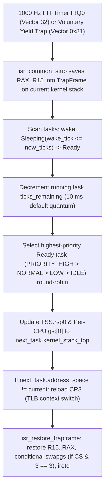

# AetherOS Preemptive CPU Scheduler

See also [PROCESS_AND_SCHEDULING.md](file:///home/ubeyt/Belgeler/AetherOS/PROCESS_AND_SCHEDULING.md).

## 1. Preemptive Scheduling Flow (`kernel/src/sched/mod.rs`)

## 2. Priority Levels & Fairness
- `PRIORITY_HIGH (3)`: Interactive and high-priority system tasks.
- `PRIORITY_NORMAL (2)`: Default user-space processes (`/sbin/init`, `/bin/aethersh`, utilities) and worker kernel threads.
- `PRIORITY_LOW (1)`: Background batch tasks.
- `PRIORITY_IDLE (0)`: `idle/0` `hlt` loop (selected only when no higher-priority task is `Ready`).
- **Preemption Verification**: `test_preemptive_multitasking_and_sync` spawns two competing CPU+Mutex threads without voluntary yields in their compute loops and verifies hardware timer preemptions (`preemptions=5, switches=12, mutex_val=250`).
