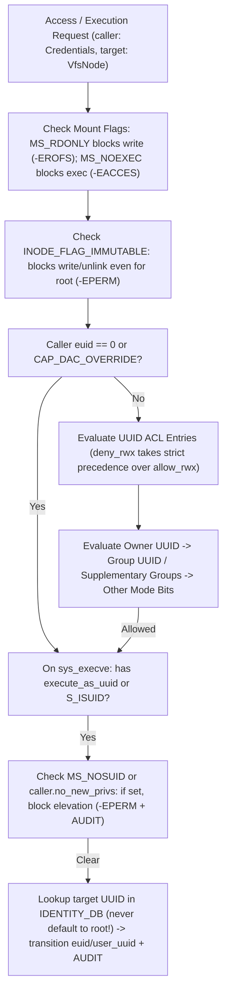

# AetherOS Security Model

See also [SECURITY_HARDENING.md](file:///home/ubeyt/Belgeler/AetherOS/SECURITY_HARDENING.md), [PERMISSIONS_AND_ACL.md](file:///home/ubeyt/Belgeler/AetherOS/PERMISSIONS_AND_ACL.md), and [SUDO_AND_PRIVILEGE_MODEL.md](file:///home/ubeyt/Belgeler/AetherOS/SUDO_AND_PRIVILEGE_MODEL.md).

## 1. Permission & Execution Identity Evaluation Flow

## 2. Core Security Guarantees
1. **Least Privilege by Default**: Normal processes run in Ring 3 without capabilities (`caps_effective = 0`) and cannot read or write kernel memory (`PTE_USER = 0` on `PML4[256..512]`).
2. **Protected Execution Metadata**: `execute_as_uuid` is stored in protected inode metadata (`VfsNode` / `AetherInode`), modifiable only by `root` (`SYS_SET_EXECUTE_AS`), and automatically cleared whenever file contents or ownership change.
3. **Immutable Audit Trail**: Every `SET_EXECUTE_AS`, `DENIED_SET_EXECUTE_AS`, `EXEC_AS_TRANSITION`, `BLOCKED_EXEC_ELEVATION_NOSUID_OR_NNP`, `SUDO_DEV_ELEVATE_TO_ROOT`, and `USERADD` event is recorded in the kernel security audit log.
