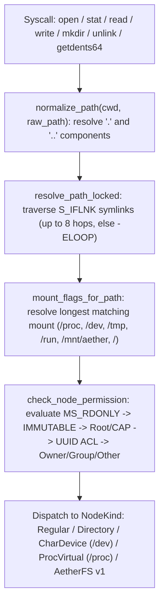

# AetherOS Virtual Filesystem (VFS) Specification

See also [VFS_DESIGN.md](file:///home/ubeyt/Belgeler/AetherOS/VFS_DESIGN.md) and [AETHERFS_SPEC.md](file:///home/ubeyt/Belgeler/AetherOS/AETHERFS_SPEC.md).

## 1. VFS Path Resolution & Mount Routing

## 2. Mount Points & Security Attributes
| Mount Target | Filesystem Type | Default Flags | Description |
| :--- | :--- | :--- | :--- |
| `/` | `ramfs` | `rw` | Root filesystem unpacked from `/boot/initramfs.tar` |
| `/dev` | `devfs` | `rw, nosuid, noexec` | Character device nodes (`null`, `zero`, `random`, `urandom`, `console`, `tty`, `serial`) |
| `/proc` | `procfs` | `ro, nosuid, noexec` | Live kernel & process diagnostic virtual files |
| `/tmp` | `tmpfs` | `rw, nosuid` | Sticky-bit (`01777`) temporary directory |
| `/run` | `tmpfs` | `rw, nosuid` | Runtime service state |
| `/mnt/aether` | `aetherfs` | `rw` | Persistent AetherFS v1 journaling volume |
